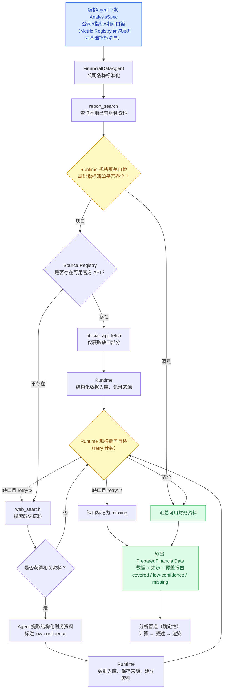

## 需求拆解

1. 财务文档：采集、检索
2. 数据来源溯源
3. 自进化机制（记忆）
4. agent能力：
	1. 指定多个公司：检索报表-->总结报表
	2. 指定多个公司：比较不同季度之间的财务数据
5. agent评估

## 需求假设

1.财务文档没有系统性爬虫机制或官方接口，需要实时agentic search
2.暂时不去做agentic search后的报表的结果验证，只做域名白名单和来源标注

## 整体设计
### 编排agent
作用：意图识别，编排流程
产出 AnalysisSpec（公司 × 指标 × 期间口径，经 Metric Registry 闭包展开为基础指标清单）下发给数据获取agent；标准报表请求派发给分析管道工具，非模板请求可用 python 工具自写逻辑（escape hatch，溯源由 runtime 强制挂载）
例如：
**帮我分析一下上次那家公司**
1.先获取最近的会话记录或者记忆，获取到对象
2.调用数据获取agent采集数据
3.调用数据分析agent数据分析
4.返回结果

帮我生成xx公司近两年每个季度的财务分析报表
1.调用数据获取agent采集数据
2.调用数据分析agent数据分析
4.根据数据agent返回的结构化数据，调用报表生成工具生成报表

接口：
数据获取agent
数据分析agent
tool列表：任务记录查询工具，报表工具，记忆工具，python工具（escape hatch）

### 数据获取agent


```
FinancialDataAgent / System Prompt

1. Role & Objective（角色与目标）
    
    明确 Agent 只负责资料准备，不负责最终财务分析。
    
2. Domain Context（领域上下文）
    
    公司名称标准化规则、Company Registry。
    
3. Source Registry（数据源注册表）
    
    已知官方 API、适用公司与调用优先级。
    
4. Workflow Policy（工作流决策规则）
    
    本地优先、官方 API 次之、Web Search 兜底。
    
5. Output Contract（输出协议）
    
    结构化资料、来源、执行状态与缺失项。
```

### 财务数据分析agent


1.数据获取


1.agent harness基座 agentscope 最新版本

