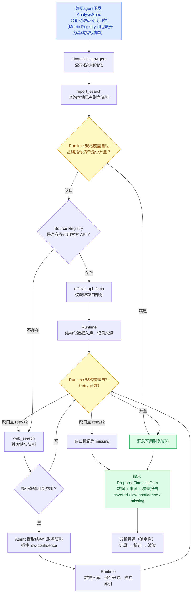

## 需求拆解

1. 财务文档：采集、检索
2. 数据来源溯源
3. 自进化机制（记忆）
4. agent能力：
	1. 指定多个公司：检索报表-->总结报表
	2. 指定多个公司：比较不同季度之间的财务数据
5. agent评估

## 需求假设

1.财务文档除了官方接口，仍需要实时agentic search
2.暂时不去做agentic search后的报表的结果验证，只做域名白名单和来源标注

## 整体设计
### 编排agent
作用：意图识别，编排流程

例如：
**帮我分析一下上次那家公司**
1.先获取最近的会话记录或者记忆，获取到对象
2.调用数据获取agent采集数据
3.调用数据分析agent数据分析
4.返回结果

帮我生成xx公司近两年每个季度的财务分析报表
1.调用数据获取agent采集数据
2.调用数据分析agent数据分析
4.根据数据agent返回的结构化数据，调用报表生成工具生成报表

系统提示词：
包含标准指标定义

tool list：
data_fetch: 内部是数据获取agent
data_analyze: 数据分析
task_list\task_search: 查询之前的任务记录
memory: 记忆工具
报表工具：生成报表
code工具：自定义python数据分析代码，用于非标指标
bash工具：用于os操作？
lookup_company工具：验证公司名称是否正确
web_search工具：查询


### 数据获取agent



```
FinancialDataAgent / System Prompt

1. Role & Objective（角色与目标）
    
    明确 Agent 只负责资料准备，不负责最终财务分析。
    
2. Domain Context（领域上下文）
    
    公司名称标准化规则、Company Registry。
    
3. Source Registry（数据源注册表）
    
    已知官方 API、适用公司与调用优先级。
    
4. Workflow Policy（工作流决策规则）
    
    本地优先、官方 API 次之、Web Search 兜底。
    
5. Output Contract（输出协议）
    
    结构化资料、来源、执行状态与缺失项。
```

### 财务数据分析agent

1.数据获取
2.校验数据coverage，数据不全，fast-fail
3.llm call，按指定格式分析出结果
4.分析结果入库

## 首版实现边界（2026-10-14）

上述设计中的编排保留为真正的 AgentScope agent，而不是固定工作流。当前落地七个原子工具：`lookup_company`、`data_fetch`、`fetch_filings`、`calculate_metrics`、`data_analyze`、`find_results`、`export_report`。模型按需组合，支持连续多轮查数据、补指标、分析、导出，也支持从头生成报告。

- 公司身份通过工具核验；首批限定 AAPL/MSFT/NVDA/AMZN/GOOGL/META。常用指标定义放提示词，自定义指标拆为基础依赖和受限算术公式，不做指标向量召回。
- 一次采集工具调用内部流式返回进度，不拆 collect_step。首版官方 XBRL 路径使用确定性 worker；目前没有可用的通用网页搜索，因此不额外制造采集模型循环。
- 结构化数据和计算结果保存为不可变产物；文字分析保存正文、有效单元格引用和限制。Excel 从这些已有产物生成，不从聊天文字提取数字。后续对话可查找并复用稳定结果 ID。
- `data_analyze` 在数值输入的必要 coverage 完整后，新建原生 AgentScope 分析 agent，复用当前 session 模型，通过 Docker 工作区的 Read/Grep/Glob/Bash/Write/Edit 自主研究输入文件；也支持纯文档输入。研究结束后用一次无工具模型调用组织流式报告。没有原文证据时只讨论数值支持的变化，不编造因果。
- 前端显示流式进度、结果表格、可点击来源与真实 Excel 下载。引用可查看原始事实、公式与输入；原文链接和已获取正文状态明确区分。
- 实测 data.sec.gov 财务事实/申报元数据可用；此前 SEC 公司目录与财报 HTML 返回 403，免费搜索 HTML 遇到 challenge。通用 web_search、非标维度与向量检索仍未启用。原始 HTML 获取及通用文件工具现已接入；配置用户提供的联系信息后，2026-10-14 已成功下载一份真实 AAPL 10-Q 并校验落盘字节，不绕过访问限制。Python/Bash 仅由内部分析 agent 在其原生 Docker 工作区使用，不替代已验证的结构化财务计算。
- 新部署首次进入页面会幂等创建用户自己的 FinanceAgent；已有 FinanceAgent 与会话沿用，凭证仍由用户在前端配置。

运行时契约以 `backend/finagent/contracts.py` 为准，schema 增量见数据结构文档 §6.2。上方流程图中的 Web Search/低可信洗数路径仍是后续设计，不代表首版已有实现。

### 报告文档交互与流式边界（2026-10-14）

- 分析在会话内显示简短文档卡。生成过程中即可打开侧栏阅读持续更新的 Markdown；完成时同一张卡绑定持久化 narrative，不重复展开全文。标题根据已授权输入的公司生成，不截取 question，也不增加标题生成模型调用。
- 当前 AgentScope 实时工具事件只携带 tool-call ID 和文字 delta，不保留内层 TextBlock ID 或中间 metadata。分析工具使用 v1 JSON-lines 的 start/progress/body/summary 记录区分标题、研究活动、正式正文和摘要；仍走原生 ToolChunk/SSE，不增加 collect_step。
- 草稿明确标注未保存/待校验；只有操作持久化成功后的最终 `metadata.finance` 是有效产物依据。传输 summary 和流结束都不等于已保存。后续编排模型只收到紧凑结果，不继承逐 delta 传输帧。
- 报告面板按会话/reply/tool-call 或 artifact ID 查找当前内容，而非复制打开瞬间的文本；正文引用复用来源面板。会话切换清理选择并取消请求；历史 narrative 沿用原数据、用新文档卡呈现。
- 数据限制归一化、去重并按选中数据范围显示。跨公司提示仅适用于多家公司；未知口径、缺失和冲突不能被吞掉。采集时的 SEC 配置提示作为历史诊断，不反复混入模型分析或导出限制。旧 Excel 不就地改写，新导出应用新的说明规则。

### 无向量的原文文件与原生分析工作区

`fetch_filings` 根据已核验公司、报告期间、申报类型或 accession，从 submissions 元数据定位 `primaryDocument`，下载原始 HTML 字节。不解构 DOM、不抽章节、不提供财报专用全文/游标工具。单批最多八份，单份最多 40 MiB；旧 submissions 查询有界，遵守 SEC 限速与有限重试。缺少真实联系配置时不尝试原文网络请求，部分成功时仍发布已下载的文档。

规范原文保存在 `FIN_DATA_DIR/filings/<sha256>.html`；以 CIK/accession/primaryDocument 对应的确切 URL 查本地索引，哈希/大小通过校验的原文长期复用，不随六小时 TTL 到期重下。显式 refresh 可强制重取；新的 accession 或主文件使用独立缓存键。submissions/companyfacts 等会变化的 JSON 仍按六小时 TTL 刷新，以发现新申报。工具进度和摘要区分缓存复用与真实下载。

数据库保存引用和来源，owned document artifact 固定哈希、大小与描述。共享来源更新不会更换历史 artifact 的原文，旧数值快照的 `metadata_only` 不改写。文档引用为 `#filing/<encoded artifact_id>`，与单元格引用独立；页面只展示元数据和附件下载，不执行原始 HTML。

每次分析由原生 `DockerWorkspaceManager.get_workspace` 创建独立工作区，写入授权资料副本及 manifest，再将 `ws.list_tools()` 的六个原生工具交给新 Agent。读取顺序和临时处理方式由 agent 决定；原生 Read 有行数/单行长度限制，必要时可用 Bash 处理。下载、读取某段、引用文档都不代表已经通读并理解全文。

研究阶段只显示工具活动，正式报告调用才发送正文。每次内部模型/工具调用归属同一 run，usage 不重复记账。初始化预算 900 秒、研究 180 秒/50 次迭代、报告 120 秒；不完整、失败、取消或迭代耗尽不发布成功 narrative。取消时等待 child 结束，再原生 close 容器并删除本次临时目录；规范原文与已保存产物不删除。

Compose 挂载 Docker socket 和同绝对路径的 `ANALYSIS_WORKSPACE_DIR`，原生 manager 负责构建镜像、创建与关闭容器，不引入自建执行器服务。实测首次镜像构建约四分钟，缓存启动数秒。模型 key 和数据库环境不复制到分析容器；网络等沿用框架默认行为。backend 拥有 Docker 管理权限，本轮只面向可信本地笔试环境，不宣称生产多租户安全隔离。

2026-10-14 用户随后提供了联系邮箱，仅写入本地 `.env`。重建 backend 后，真实 submissions 请求和一份 AAPL 10-Q 原始 HTML 下载成功：报告期间 2026-06-27，1,018,320 字节，非缓存命中，落盘 SHA-256/大小一致。此次成功不能证明此前 403 的唯一原因或保证后续 SEC 访问。下载复测没有使用绕过请求，也没有调用模型。随后用户另行授权页面实测，已用 deepseek-flash 完成一次真实原文分析，原生 Read/Grep/Bash 轨迹、引用、附件与刷新恢复通过；没有把该次有针对性的文件研究称为通读全文。实际 token 用量及报告长度未达要求的问题见验收文档。

### 可编辑财务分析 Skill 与混合证据

综合分析通常同时准备结构化数值/确定性计算结果与相应原文，交给同一次分析；单数字查询、明确纯数字/纯原文和仅导出仍按需执行，不变成固定工具流水线。空的数值输入本身不等于财务数据缺失，报告不得暴露 `numeric_cells` 等内部字段。

分析方法位于 `backend/finagent/skills/financial-analysis/SKILL.md`，覆盖增长、盈利、现金流与利润兑现、资产负债、资本配置、业务解释和风险，按问题和证据选择相关维度。方法及默认表达方式可由财务分析师维护；所有权、引用白名单、结构化计算和取消预算仍由代码保证。

使用 AgentScope 原生 `Toolkit(skills_or_loaders=[Skill(...)])`，不是不存在的 SkillMiddleware。child 通过原生只读 `Skill` 工具加载方法，再自主调用六个文件工具；权限仅放行本次 toolkit 的确切 Skill 实例。编排层仍只暴露七个业务工具。

原生 `WorkspaceService.resolve(user_id, agent_id, session_id)` 解析授权持久工作区。首次财务回复通过原生 add_skill 初始化默认方法；独立于 Skill 目录的 agent 级标记保证不覆盖已有编辑、不在移除后重装。每次分析重新 list_skills，冻结方法正文并复制到本次 Docker 工作区。研究与最终报告使用相同快照，run_steps.detail 记录名称和正文哈希，无新增数据库迁移。

当前原生界面没有正文编辑器。维护流程为本地修改 SKILL.md，保持 frontmatter 名称，再在会话 Skills 面板移除旧版并上传新版文件夹。只读 Skill 库和工作区附加副本相互独立；更改仓库模板或库副本不会自动改写已附加版本。修改在下次分析生效，无需重建；当前运行和历史报告保持原快照。移除后使用基础证据规则并提示未附加方法，不假装仍加载了 Skill。

报告阶段也接收同一方法正文作为指令，用户的语言、字数和格式优先于默认风格；数值结论引用单元格，原文原因/风险引用文档。当前 manifest 是本次资料可用范围，旧表格文件的历史“未下载原文”说明不覆盖当前输入，也不据此改写旧快照。

